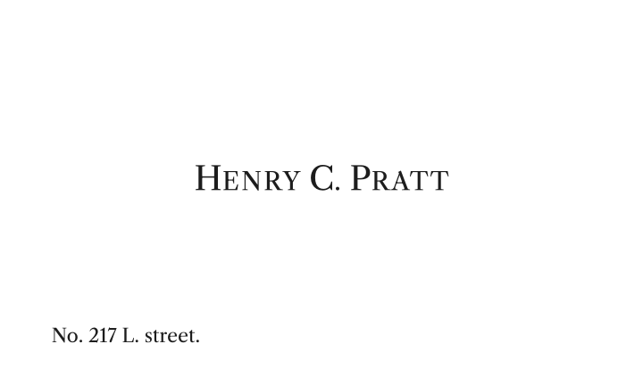
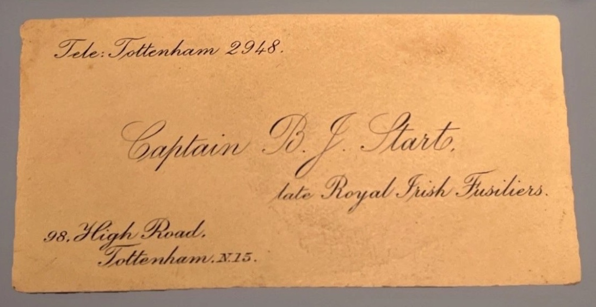
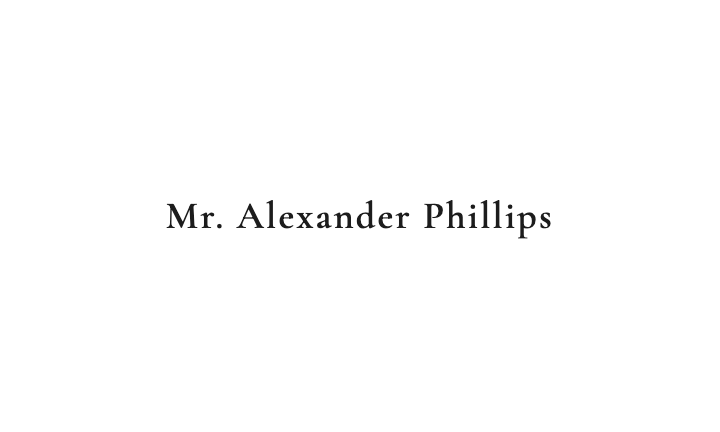
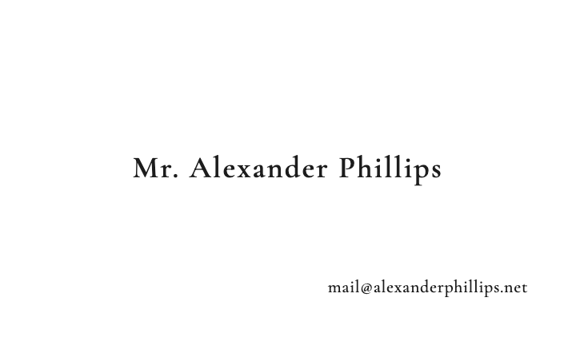

#+title: Calling Cards, Then and Now
#+date: [2026-11-15 Sun]
#+book: The Gentlemen's Book of Etiquette and Manual of Politeness
#+book_author: Cecil B. Hartley
#+book_year: 1860
#+book_link: https://www.gutenberg.org/ebooks/39293
#+filetags: :etiquette:calling_cards:
#+description: Do calling cards have any place in modern society?

While most of Hartley's book felt outdated (apart from the core message, which I took to be that a gentleman is as kind as possible to everyone he encounters), his chapter on calling, and in particular /calling cards/, interested me quite a bit.

Hartley is pretty straightforward when it comes to what goes on a calling card:[fn:1]

#+begin_quote
A card should have nothing written upon it, but your name and address. To leave a card with your business address, or the nature of your profession written upon it, shows a shocking ignorance of polite society.
#+end_quote

So, quite different from a business card, where the objective is to get contacted back in connection to your profession. When he wrote about it in 1860, calling cards were very serious business, and there were many etiquette rules related to them.

#+caption: The ideal calling card in Hartley's eyes.
#+attr_html: :width 360

Notice how the address is printed on the bottom left side of the card in his example. That remained true at least until the early 1920s (I obtained a vintage calling card from a man that fought in World War I that confirms this), but that standard changed at some point to where the address on calling cards and business cards is now printed on the bottom right side.

#+caption: Captain B. J. Start's calling card.
#+attr_html: :width 360

* What changed
This is just speculation on my part, but calling cards likely went out of use with the rise and spread of telephones. Captain Start's card does show his phone number, but there was likely some overlap between the rise of phones and the fall of calling cards. Note that Captain Start lived in London, while Hartley was writing for Americans.

Showing up unannounced at an acquaintance's place is also frowned upon in the United States, although apparently this is more common in the UK.[fn:2]

* What survives
It is rare to find modern calling cards still being sold, but some institutions such as Dempsey & Carroll still sell [[https://www.dempseyandcarroll.com/collections/bespoke-stationery-correspondence-business-calling-cards][modern versions]] on their website.[fn:3] Modern use of these cards also feels quite limited.

* My plan
I was thinking that a way to use modern calling cards would be to write small thank-you notes on the back of the card and hand them out to people who have been helpful. It's also an easy way to keep in touch with people without having to pull out your phone to exchange information. If you want to share your number, you can also quickly write it on the back of the card.

A modern version of a calling card would likely have an email address instead of a physical home address, which is seen as too much of a privacy invasion these days. I plan to get a few calling cards printed and test them out; I'm still deciding between the following two options:

#+caption: Option one: just my name.
#+attr_html: :width 360

#+caption: Option two: my name and email address.
#+attr_html: :width 360

Hartley said it's a matter of taste whether to add or leave out the “Mr.” on the card, but I think it looks nice. Let's see how it goes.

[fn:1] Chapter V, “Etiquette for Calling.” Chapter XVIII, “Miscellaneous,” has more rules for cards.

[fn:2] Christian Bale [[https://www.youtube.com/watch?v=QJyeOWZkuAI][hated his move to Los Angeles]] because of this.

[fn:3] These aren't cheap, by the way.
