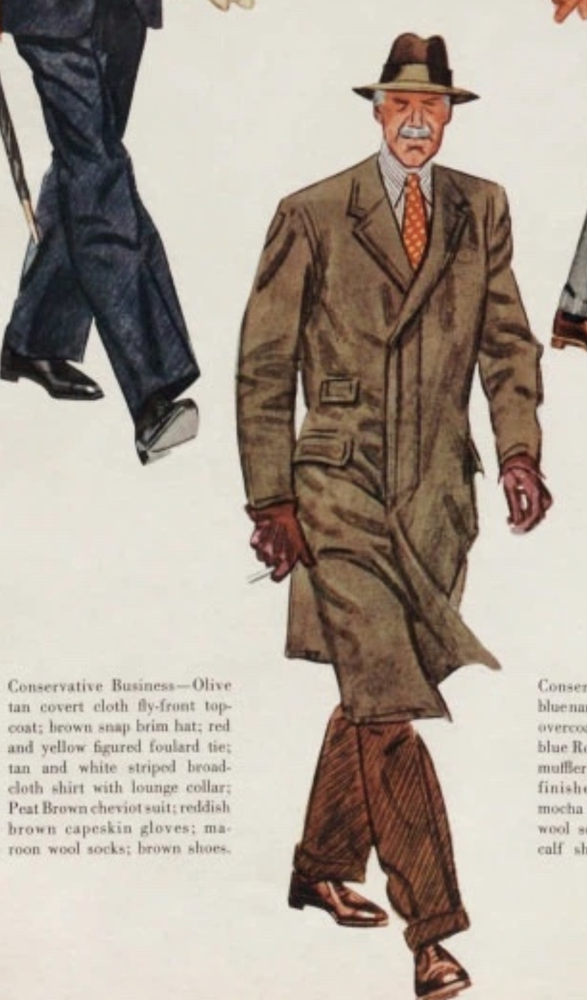

#+title: Brown in Town
#+date: [2026-11-14 Sat]
#+type: note
#+category: Clothes
#+filetags: :city:brown:town:apparel_arts:
#+description: Is brown ever acceptable for business attire?

Every menswear enthusiast is aware of the old tradition of wearing black oxford shoes for serious business appointments in the city and reserving brown (often brogued) shoes for leisurely countryside activities.[fn:1] This “rule” also extended to the entire outfit; navy blue and gray were “serious” colors intended for a business suit, while earthy colors like brown, beige and olive were a lot less so.

Members of the menswear communities online will reassure you that there are no iron-clad rules in menswear, but these same people will refuse to shake your hand if you violate said rules. Push too far and menswear celebrities will physically fight you.[fn:2]

So imagine my surprise when I was browsing through an old /Apparel Arts/ magazine from 1940 (the magazine considered by many in the menswear community to be one of the few sources of “truth”) and I stumbled across a page where the magazine advises several outfits for a variety of occasions and includes a very earthy-toned suit with brown shoes as a conservative business outfit.[fn:3]

#+caption: An outfit apparently appropriate for conservative business.

My tastes have been shaped from years of browsing StyleForum and reading menswear books, so I have to say that this outfit assaults my sensibilities for business attire. It is worth noting that earlier within the same issue, the color of the suit “Peat Brown” was referred to as “the new focal shade of fashion,” so this could just be the magazine trying to promote the season's color.

Still an interesting find, nonetheless.

[fn:1] Derek Guy often references it in examples such as [[https://x.com/dieworkwear/status/1724135244000039379][this one]].

[fn:2] Even the author of [[https://timesofindia.indiatimes.com/etimes/trending/menswear-guy-to-fight-a-guy-outside-a-fast-fashion-store-in-san-francisco-heres-why/articleshow/120038622.cms][this /Times of India/ article]] can barely hold back his hatred of menswear enthusiasts.

[fn:3] /Apparel Arts/, October–November 1940, [[https://assets.paulrand.design/Works/Apparel%20Arts/vol%2011%20no%202%20October-November%201940/Web/Apparel%20Arts%20Magazine%20vol%2011%20no%202%20October-November%201940%2031.webp][p. 60]].
